# PANGEA Desktop 新手使用指南

从准备源码开始，完成一次分析，读懂流程与风险，筛选并导出可用的测试用例。

适用环境：Windows x64。界面基线为 Desktop `a23cd31`、工作台插件 `7cc5179`、分析引擎 `7aa7abc`，核对日期为 2026 年 10 月 22 日。完整提交与安装包核对方法见[版本与资料依据](#版本与资料依据)。

PANGEA Desktop 是一个面向源码分析与测试设计的工作台。你提供源码、分析目标和可选的需求等资料，它组织分析与复核，并把业务流程、风险、测试用例和报告放在同一项任务里。

第一次使用，建议选择一个你熟悉的小模块，采用“模块分析”，先走通下面的流程。

首次使用可按正文顺序操作；已有任务时，可直接查阅[真实案例中的结果判断](#真实案例中的结果判断)、[源码更新后重新分析](#源码更新后重新分析)或[按现象排查问题](#按现象排查问题)。范围选择中的目录示例用于解释怎样划定工作边界，真实案例中的产物用于练习怎样做测试判断。

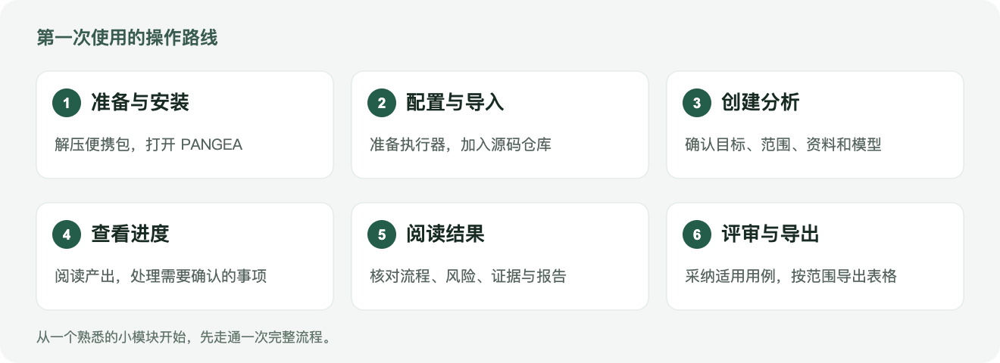

> 配图说明：图 1–17 使用配套版本的实际工作台组件，展示示例任务和模型数据；窗口外框为演示环境。图 18–19 来自随包的真实产物阅读页，保留历史记录与冻结源码节选，并单独标明评审建议。

## 开始前准备什么

| 准备项 | 你需要做什么 |
| --- | --- |
| Windows x64 电脑 | 准备一个可写目录，用于解压程序；为源码副本和分析结果预留空间。 |
| PANGEA Desktop 完整便携包 | 从团队的软件交付位置获取配套版本的 ZIP。首次安装使用完整包。 |
| 待分析的源码 | 准备一个本机源码目录。普通目录也可以使用；有 Git 历史的仓库会连同历史一起复制。 |
| 分析执行器和模型账号 | 本文完整演示 OpenCode 的安装、登录与验证。准备一个获准使用的模型服务账号或 API Key；已有 NGA / CodeAgent 部署的用户可沿用已有执行器。 |
| 明确的分析目标 | 例如“TLS 握手与失败清理”，并知道相关代码所在的目录。 |
| 需求等补充资料 | 可选。首次模块分析可以只使用源码；覆盖率分析需要可用的覆盖率输入。 |

便携包已包含 PANGEA 工作台和 Python 运行环境。安装后的分析仍需要能够访问所选执行器的模型服务。

## 安装并打开工作台

1. 将完整 ZIP 解压到可写目录，例如 `D:\Apps\PANGEA Desktop`。
2. 打开解压后的目录，双击 **PANGEA Desktop.exe**。
3. 等待工作台加载。首次使用时，按照页面引导加入源码仓库；已经初始化的工作区会进入工作台。

若出现 **配置模型与 API** 引导，可以点击 **打开模型与 API 设置**。已经准备好外部 Agent、暂时只做源码分析时，也可以选择 **稍后配置**，先加入源码。

本指南对应的 Windows 便携版将源码副本、任务和报告放在**程序目录下的 `launch-root\pangea-data`**。例如上述安装位置对应 `D:\Apps\PANGEA Desktop\launch-root\pangea-data`。`%APPDATA%\pangea-desktop` 还保存应用配置和升级记录。保留数据时需要同时考虑这两处；开发模式或专用测试入口的工作区可能另有位置。

### 先认识几个入口

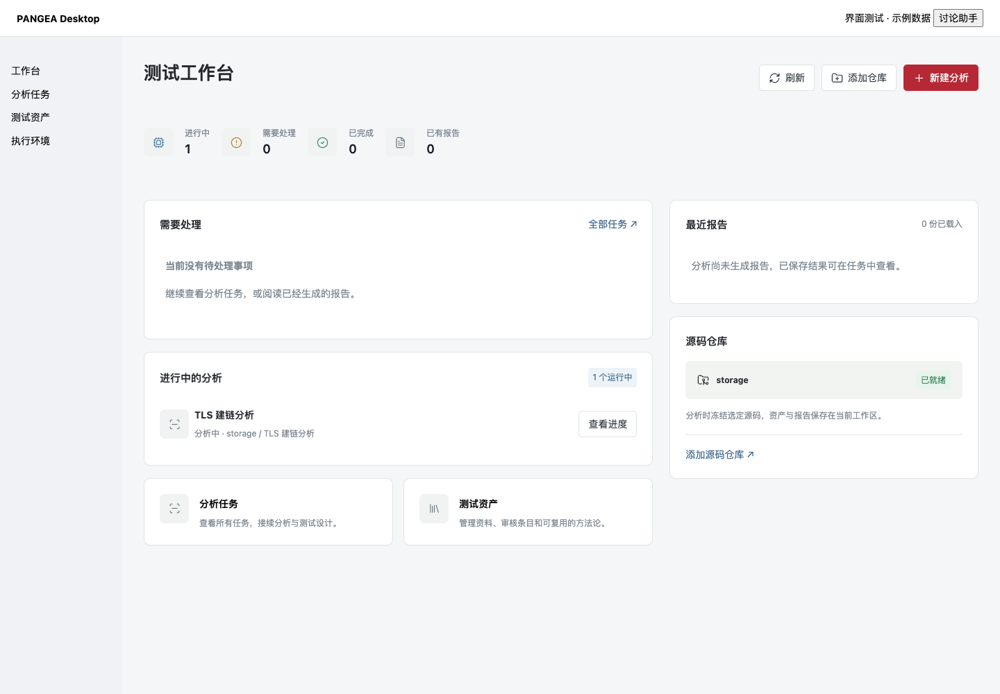

*图 1　工作台集中展示需要处理的任务和正在进行的分析。首次使用时列表可能为空。*

| 入口 | 用来做什么 |
| --- | --- |
| 工作台 | 添加仓库、新建分析、查看当前进度和需要你处理的事项。 |
| 分析任务 | 找到某次分析，查看它的运行记录、结果和报告。 |
| 测试资产 | 导入需求、设计、历史缺陷、参考资料和覆盖率等材料。这里的“资产”就是可以用于分析的资料。 |
| 执行环境 | 管理实际执行用例所需的环境。第一次完成源码分析时可以先跳过。 |
| 设置 | 查看分析执行器入口，配置讨论助手模型，导入升级包。 |

界面中的 **Run** 表示一次具体的分析运行。阅读历史结果时，先确认当前任务名称、仓库和运行记录，避免把不同版本的结果混在一起。

## 配好分析执行器和讨论助手

打开 **设置**，可以看到“分析执行器”和“讨论助手模型”两组入口。

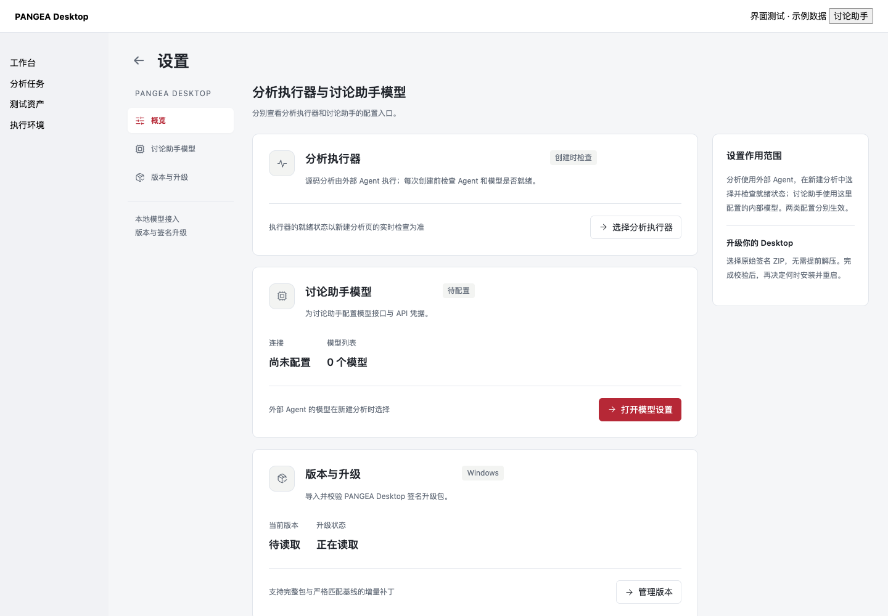

*图 2　源码分析与讨论助手分别配置；创建任务时会再次检查执行器和模型是否可用。*

### 分析执行器

分析执行器是实际读取源码、完成分析与复核的外部 Agent。当前支持 **NGA、CodeAgent、OpenCode**。

下面以 **OpenCode 1.18.4 的 Windows 原生安装**为例。它适合能安装命令行工具、且有模型服务访问权限的电脑。已部署 NGA 或 CodeAgent 的用户可直接在 **新建分析 → 执行设置** 选择已有执行器，并完成下表的模型确认与首个任务检查。

#### 安装并确认命令可用

1. 从 [Node.js 官方下载页](https://nodejs.org/en/download)安装 Windows x64 的 LTS 安装程序，保留 npm 组件和命令环境配置。npm 是安装 OpenCode 所用的软件包工具。
2. 打开一个新的 **Windows PowerShell**，依次执行：

```powershell
node --version
npm.cmd --version
npm.cmd install -g opencode-ai@1.18.4
```

前两条应显示版本号；安装命令成功结束后，重新打开 PowerShell，检查：

```powershell
Get-Command -CommandType Application opencode
opencode.cmd --version
opencode.cmd acp --help
```

应分别看到命令路径、`1.18.4` 和 `acp` 帮助。ACP 是 PANGEA 与执行器通信的接口。本文选用 npm 安装的 `.cmd` 入口，可避开 PowerShell 对 `.ps1` 脚本的策略限制。仅在 WSL 中安装 OpenCode，不代表 Windows 程序能找到它。

这条路线依据 [OpenCode 官方安装说明](https://opencode.ai/docs/#install)与 [ACP 接口说明](https://opencode.ai/docs/acp/)。后续换用其他版本时，重新检查命令、模型和实际请求；OpenCode 1 与 2 共用命令名，安装前先确认已有版本。

#### 登录并验证一次模型请求

在 PowerShell 中执行：

```powershell
opencode.cmd auth login
```

在交互列表里选择你已获准使用的模型供应商，完成浏览器登录或输入该供应商的 API Key。凭据填在 OpenCode 的登录流程中。随后执行：

```powershell
opencode.cmd models
```

从结果中复制一个完整的 `供应商/模型` ID。模型出现在目录里，仍需通过一次实际请求确认账号权限和网络。先在资源管理器中新建一个空文件夹，例如 `D:\PangeaConnectionCheck`，进入该文件夹，在地址栏输入 `powershell` 并回车，再执行下列命令，将 `供应商/模型` 替换为刚才复制的值：

```powershell
opencode.cmd run -m "供应商/模型" "请只回复 PANGEA_READY，不读取或修改文件，不调用工具。"
```

收到 `PANGEA_READY` 或相应简短回复，说明这个账号和模型此时可以完成请求。若失败，先按[模型与网络问题](#模型与网络问题)定位，再进入任务创建。登录、模型列表和单次请求的命令说明见 [OpenCode CLI 文档](https://opencode.ai/docs/cli/)。

**企业自定义网关：** 先向账号管理员取得 **API 协议、完整接口地址、模型 ID、本人凭据**。全局配置默认位于 `%USERPROFILE%\.config\opencode\opencode.json`；若组织另设配置位置，以其配置为准。按[自定义供应商说明](https://opencode.ai/docs/providers/#custom-provider)添加供应商，凭据中的供应商 ID 必须与配置中的 ID 一致。配置为全局后，Desktop 的分析目录才能读取同一连接；随后仍执行上述模型列表和短请求检查。

代理和企业证书按 [OpenCode 网络配置](https://opencode.ai/docs/network/)设置。让启动 Desktop 的进程继承这些配置；另一个 PowerShell 窗口里的临时设置不会自动传给已运行的 Desktop。

#### 在 PANGEA 中确认接入

1. 重新打开 PANGEA Desktop。先按后文完成[源码导入](#把源码加入-pangea)及[创建向导的前两步](#创建第一次分析)，再到第三步 **执行设置 → 外部 Agent** 选择 **OpenCode**。
2. 点击 **刷新模型**，选择刚才测试过的模型，确认页面显示 **已确认模型：具体模型 ID**。
3. 完成后文的小范围分析创建，在 **执行详情与 Agent 会话** 中确认有新消息、工具活动和阶段产物。

若 Desktop 找不到执行器，打开 **Agent Runtime → 高级启动设置与诊断**，核对 **绝对路径** 和 **命令解析**。需要自定义路径时，将 `Get-Command` 查到的 `.exe` 或 `.cmd` 路径填入 **启动命令**，**启动参数（每行一个）**填 `acp`。点击 **保存配置**；在没有运行中的分析时，按提示 **立即重启 Harness**，再刷新模型。Harness 是承载分析的后台进程。启动命令不要填成 npm 的 `.ps1` 文件。

| 看到的信号 | 到了哪一步 |
| --- | --- |
| 运行时已加载、检查运行时通过 | 命令和执行器注册可用；登录与模型请求仍需检查。 |
| 模型列表有值、已确认具体模型 | PANGEA 已取得该执行器的模型目录。 |
| 同模型短请求有回复 | 当前账号、网络与模型能完成一次请求。 |
| 首个任务产生会话消息和阶段产物 | PANGEA 到执行器的分析链路已经开始工作；完成后仍需阅读结果。 |

### 讨论助手模型

讨论助手用于围绕当前结果提问，例如解释风险依据、讨论测试步骤。

1. 打开 **设置 → 讨论助手模型**。
2. 首次配置时点击 **连接模型接口**；已有连接时可点击 **打开模型设置**。
3. 按团队提供的信息填写 **提供方 ID、接口地址、API 协议、API 密钥**。API 密钥是模型服务提供的访问凭据。
4. 点击 **查询可用模型**，或通过 **添加一行**填写服务提供方给出的模型 ID。核对模型列表后点击 **创建连接**，并按界面选择可用的默认模型。
5. 重新打开设置，确认连接仍在。完成后文的任务创建后，在任务页点击 **AI 助手**，发送一条简短消息，确认服务可以回复。

内部 API 模型也可用于资料提取。源码分析则在创建任务时使用外部 Agent；只配置讨论助手的 API，不等于已完成分析执行器的准备。

## 把源码加入 PANGEA

第一次打开时，在欢迎页点击 **选择文件夹**，选择源码目录，核对 **仓库名称**，再点击 **完成初始化**。

已经进入工作台后，使用右上角 **添加仓库**。也可以在新建分析的“源码仓库”旁点击 **添加**。

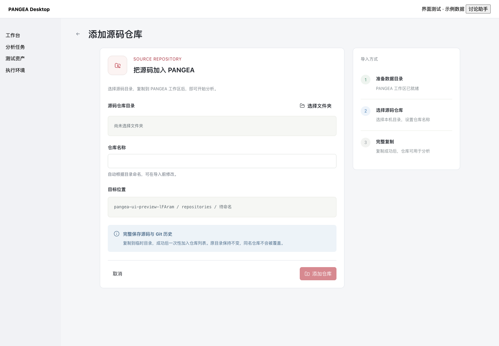

*图 3　选择本机目录，核对仓库名称和目标位置，随后点击“添加仓库”。*

1. 选择源码所在的文件夹，例如 `D:\Code\storage`。
2. 核对自动填写的仓库名称，可在导入前修改。
3. 点击 **添加仓库**，等待完整复制结束。
4. 确认该仓库出现在工作台或新建分析的仓库列表中。

导入会创建独立的源码副本，原目录保持不变；已有同名仓库不会被覆盖。复制期间保持窗口打开，等仓库正式出现在列表后再开始分析。

> 后续分析使用 PANGEA 工作区里的源码副本。原目录更新后，按[源码更新后重新分析](#源码更新后重新分析)重新导入并核对版本，再开始新任务。

## 创建第一次分析

点击 **新建分析**。创建向导依次包含 **分析目标、输入资料、执行设置、确认创建** 四步。

本节用一个示例贯穿操作：源码仓库为 `storage`，分析目标为“TLS 建链分析”，关注握手与失败清理行为，源码范围为仓库内的 `tls/`。操作时请替换成自己的仓库、目标和路径。

### 第一步明确目标和源码范围

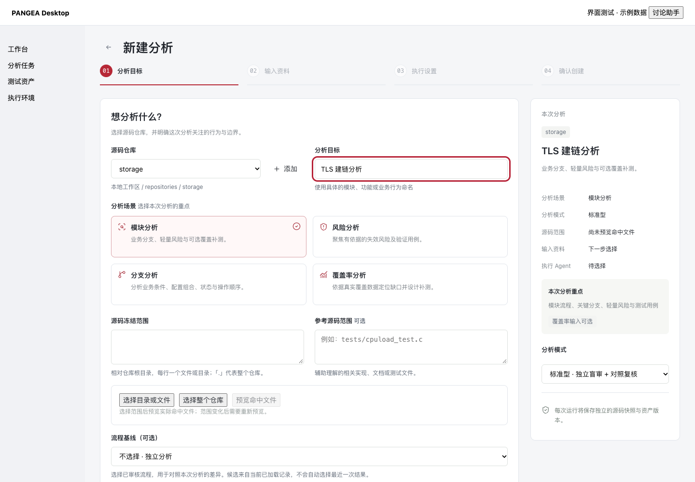

*图 4　先选仓库、写清目标，再选择场景、模式和源码范围。*

1. 在 **源码仓库** 中选择已导入的仓库。
2. 填写 **分析目标**。使用具体的模块或业务行为名称，例如“TLS 握手与失败清理”。
3. 选择 **模块分析**，先完成一次综合分析。
4. 在 **分析模式** 中选择适合本次任务的模式。首次可以采用 **标准型**。

四种场景的区别如下。

| 分析场景 | 适合的目标 |
| --- | --- |
| 模块分析 | 了解一个模块的流程、关键分支、轻量风险，并设计测试用例。 |
| 风险分析 | 聚焦有源码依据的失效风险、触发条件和验证用例。 |
| 分支分析 | 梳理业务条件、配置组合、状态变化和操作顺序，补齐相关用例。 |
| 覆盖率分析 | 结合真实覆盖数据，定位缺口并设计补充测试；必须提供可用的覆盖率输入。 |

**标准型**包含独立盲审和对照复核：先独立检查，再比较结果和分歧。**速度型**由审核者直接检查已有结果，跳过盲审。两种模式都会保留各自的复核信息，实际耗时取决于源码规模和模型执行情况。

接下来，明确本次要分析哪些源码。

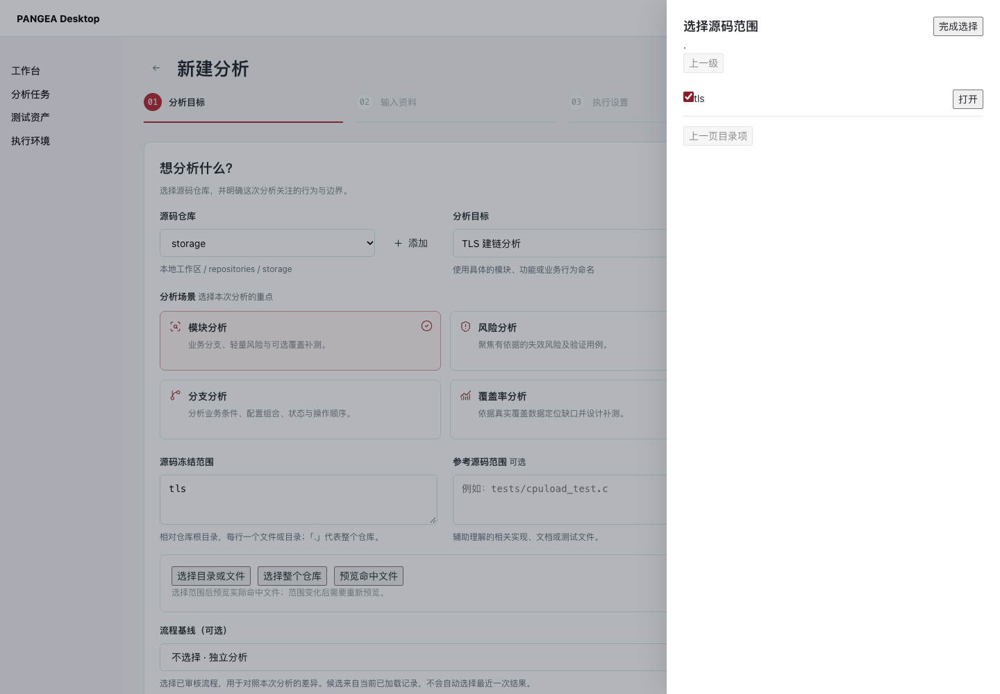

*图 5　示例数据：通过目录树选择范围，本次只选择 `tls` 目录。*

5. 点击 **选择目录或文件**，勾选目标目录或文件，再点击 **完成选择**。也可以在 **源码冻结范围** 中填写相对仓库根目录的路径，每行一个。
6. 如果确实要分析整个仓库，点击 **选择整个仓库**。界面会用 `.` 表示仓库根目录。
7. 点击 **预览命中文件**，核对实际文件清单和数量。

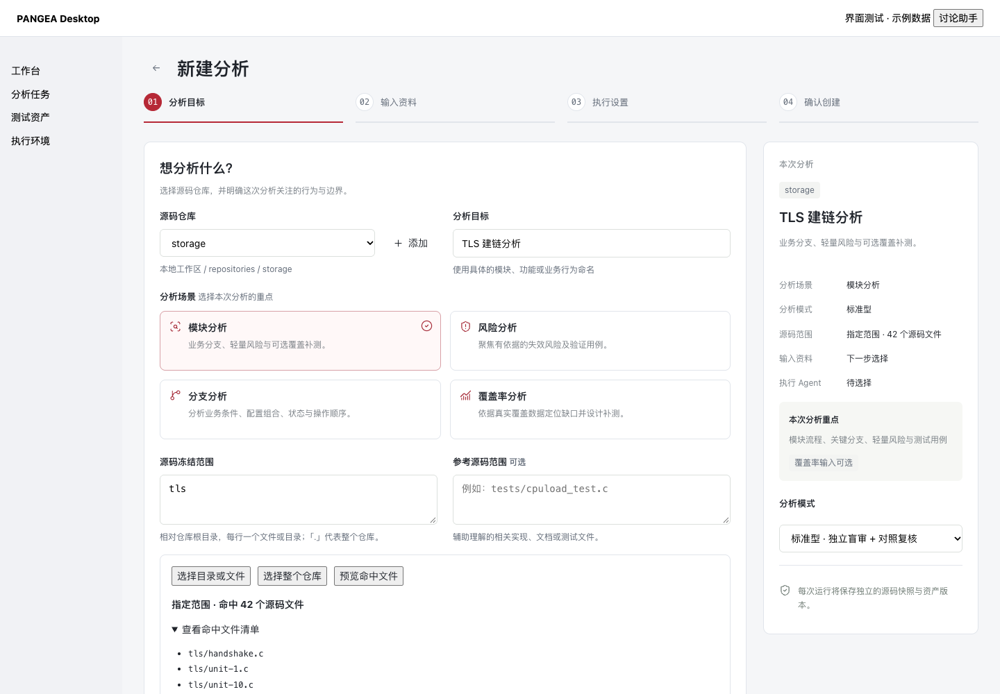

*图 6　示例范围命中 42 个源码文件。你的任务应以自己的预览结果为准。*

**文件清单符合目标后再继续。** 范围为空、预览失败或命中数为 0 时，不能进入后续步骤。修改范围后需要重新预览；若创建时提示文件集合变化，也应重新核对。

**源码冻结范围**是本次要正式分析的文件集合；**参考源码范围**是为理解这些文件而补充的材料。主范围不会自动补齐整个依赖链。参考范围每行填写一个具体文件，不能填写目录，也不能与主范围重复。辅助文件会随任务一起保存，但不会因此变成主分析对象。

#### 用目录判断哪些代码应进入主范围

下面是用于讲解职责的目录示例，文件名请替换成自己的工程路径：

```text
storage/
├─ tls/
│  ├─ handshake.c           握手状态推进和失败出口
│  └─ key.c                 密钥解析与校验
├─ common/
│  └─ transport.c           连接关闭、资源释放和重新建链
├─ include/
│  └─ tls.h                 对外接口和返回值约定
├─ tests/
│  └─ tls_test.c            已有测试
└─ docs/
   └─ tls-requirements.md   需求与行为约束
```

目标是“TLS 握手与失败清理”时，先回答一个问题：**如果 `common/transport.c` 的关闭或释放行为写错，本次分析是否应该发现？** 如果答案是“应该”，它就是主范围的一部分。

本例主范围填写：

```text
tls/
common/transport.c
```

参考范围填写：

```text
include/tls.h
tests/tls_test.c
docs/tls-requirements.md
```

接口声明用于判断调用是否合法，已有测试用于理解当前覆盖，需求用于判断预期行为。若目标只是“密钥解析是否正确”，可以把主范围缩到 `tls/key.c`，将握手调用处放入参考范围；如果还要检查连接释放，就需要把负责释放的实现重新纳入主范围。公共模块是否进入主范围，取决于本次要对它的什么行为作出结论。

点击 **预览命中文件** 后，按职责核对四件事：入口文件是否在内、关键状态判断是否在内、成功和失败出口是否在内、清理责任是否落到具体实现。预览的 **42** 是配图中的示例数量，只表示筛选命中，不能证明范围完整。当前预览统计主范围中支持的 C/C++ 或 Lua 源码；运行时保存的参考文件也会出现在冻结清单中，因此两处文件数可能不同。

**流程基线**是一份已审核的历史流程，用于比较流程结构的变化。第一次独立分析保持 **不选择 · 独立分析**；重复分析时，只有确认它来自同一目标和适用的源码范围后再选。基线必须已完成、审核通过且不是部分交付。它不负责更新源码，旧结论仍需结合本次版本重新判断。

点击 **下一步 · 输入资料**。

### 第二步选择输入资料

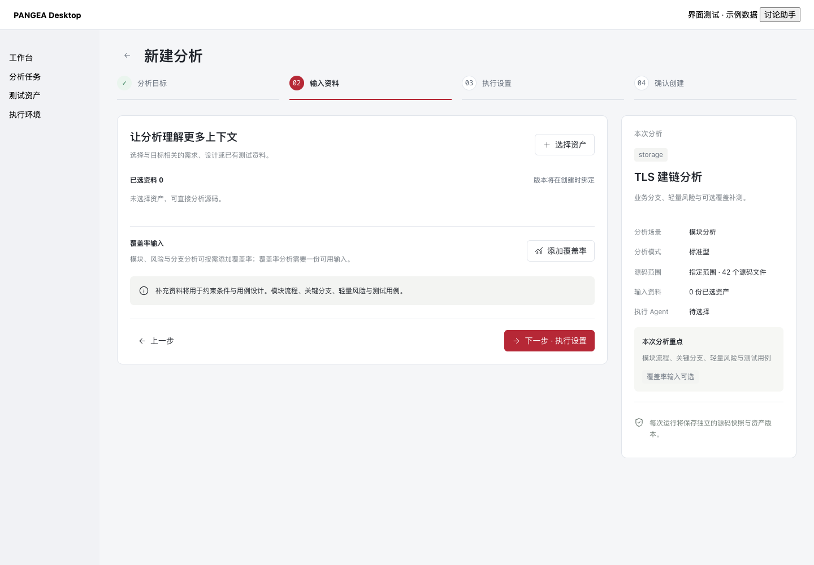

*图 7　模块分析可以不选资产，直接使用源码；有相关材料时，再从资产库中选择。*

已有需求、设计或历史缺陷资料时，点击 **选择资产**，选择与本次目标相关且可用的资产，核对标题和版本。

第一次做模块分析，没有补充资料也可以直接点击 **下一步 · 执行设置**。如果需要先导入材料，按后文“补充需求和历史缺陷资料”操作。

覆盖率分析需要点击 **添加覆盖率**，按当前环境选择平台查询、本地覆盖率文件或已有覆盖率资产。查询成功表示取到了数据，是否匹配本次源码会在运行中核验。

### 第三步选择执行器和模型

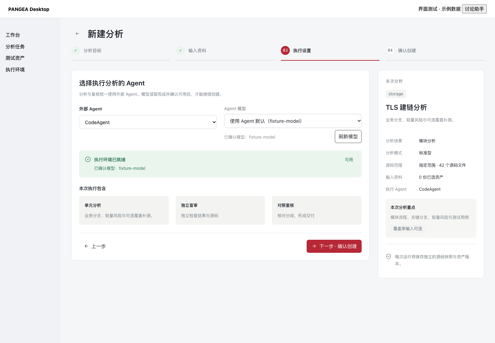

*图 8　模型列表来自所选 Agent。示例模型仅用于界面展示，操作时选择你实际可用的模型。*

1. 在 **外部 Agent** 中选择本机已配置的 NGA、CodeAgent 或 OpenCode。
2. 等待 **Agent 模型** 列表读取完成。必要时点击 **刷新模型**。
3. 选择所需模型；使用 Agent 默认模型时，也需要成功确认其具体模型。
4. 看到 **执行环境已就绪** 后，点击 **下一步 · 确认创建**。

若列表读取失败、没有可用模型或所选模型失效，先处理页面提示再继续。切换执行器后，应重新检查该执行器的模型。

### 第四步确认并开始

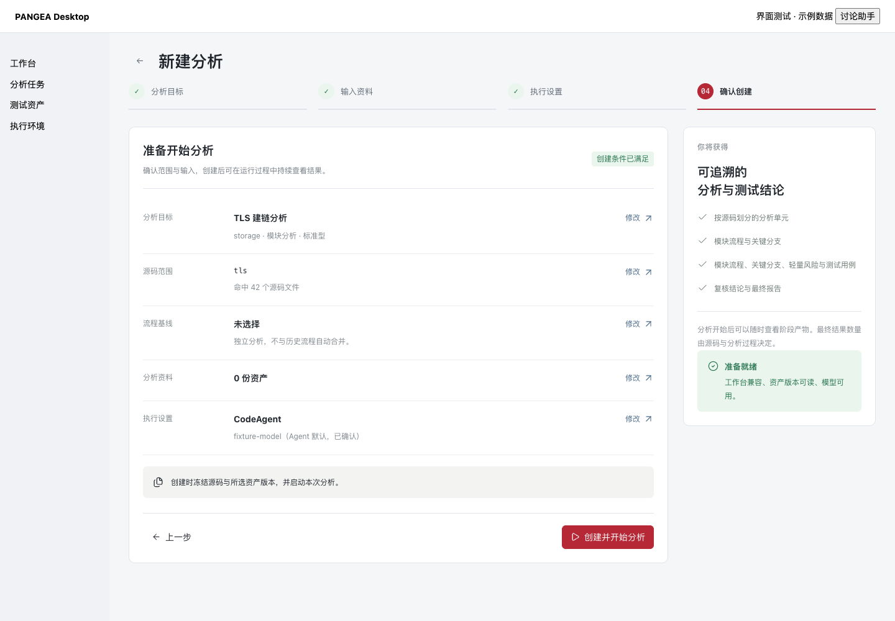

*图 9　提交前集中核对目标、源码范围、资料版本和执行模型。*

逐项确认：

- 仓库和目标是否正确。
- 源码范围与命中文件数是否符合预期。
- 是否选中了本次需要的资料。
- 执行器和具体模型是否正确。

需要调整时，点击对应行的 **修改**。确认无误后，点击 **创建并开始分析**。

创建时会保存本次源码快照和所选资产版本。“快照”就是本次分析使用的固定内容，方便以后核对结果依据。修改原始材料后，新的分析任务才能使用更新后的输入。

## 查看进度和处理待办

任务开始后，进入 **运行过程**。重点看当前阶段、已经保存的产出和需要处理的事项。

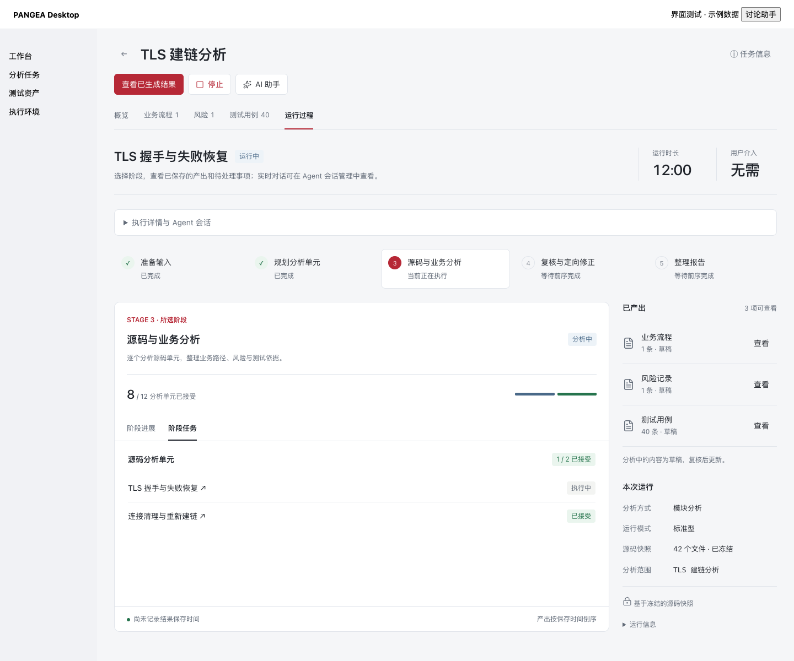

*图 10　示例运行状态：阶段条显示当前进度，下方“阶段任务”列出各单元的状态。图中时长用于演示。*

需要查看具体执行消息时，展开 **执行详情与 Agent 会话**，点击 **Agent 会话管理**。在会话中核对报错、工具输出和最近进展。

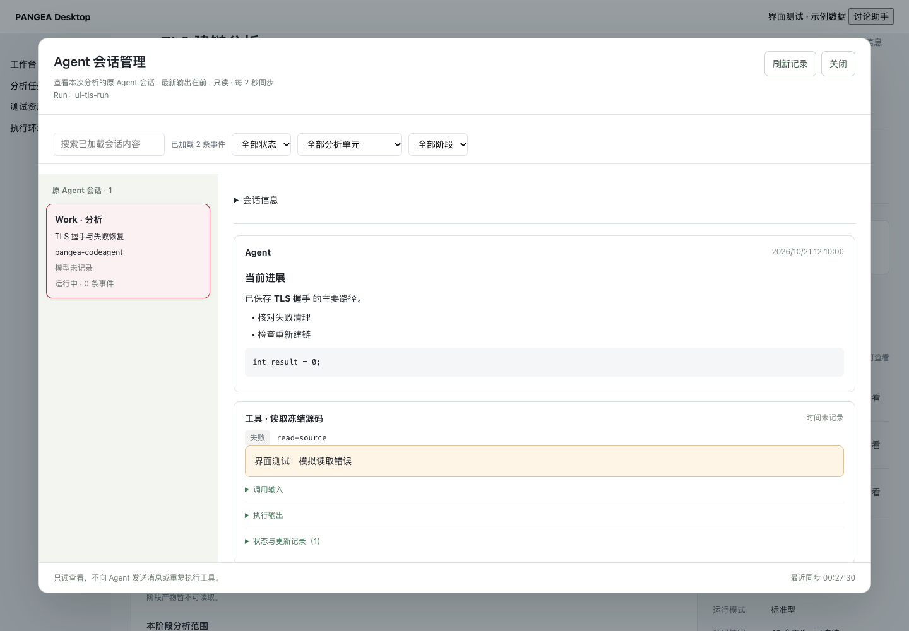

*图 11　消息与工具输出可以展开阅读。图中的读取错误是演示数据。*

| 页面状态或提示 | 接下来怎么做 |
| --- | --- |
| 正在运行 | 阅读阶段产出或继续其他工作，留意最新活动和页面提示。 |
| 需要处理、等待修正 | 阅读原因，按页面提供的入口选择“继续修正”或“交付已有结果”。 |
| 启动失败或分析失败 | 查看失败原因和对应会话，按后文对应现象排查。旧工具结束状态未确认时，先保留原 Run 并完成结束确认。需要更换源码范围或输入资料时，新建分析。 |
| 正在停止 | 等待停止结果确认。 |
| 已停止 | 查看已有产物；页面允许恢复时，可点击“继续分析”。 |
| 已完成或已有交付 | 进入结果概览和报告，核对交付范围、质量结论与待处理事项。 |

要主动停止时，使用页面的 **停止** 并完成确认。要保留已完成部分结束当前修正时，使用 **交付已有结果**，并继续阅读报告中的未解决项。

**流程结束与问题全部解决是两个不同状态。** 部分交付会保留已经完成的结果，也会明确记录未完成修正和 `UNRESOLVED`，即仍未解决的事项。

## 读懂结果和业务流程

### 先看结果概览

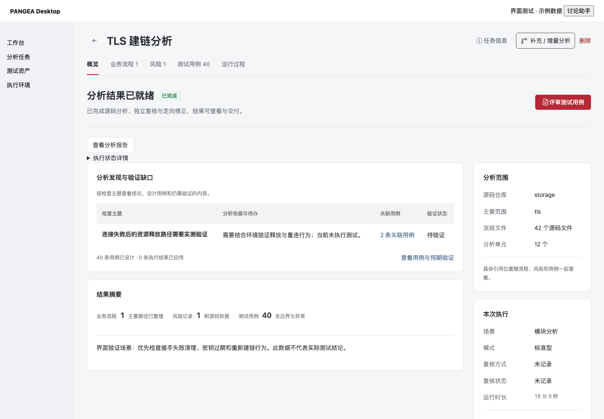

*图 12　先看分析发现与验证缺口，再进入具体流程、风险、用例和报告。*

建议按以下顺序阅读：

1. **确认任务和范围**：检查仓库、目标，以及本次运行记录。
2. **查看发现与待办**：先阅读未解决事项、风险与验证缺口。
3. **查看业务流程**：理解模块的正常路径、异常路径和关键分支。
4. **核对风险和证据**：把结论与对应的源码或资料联系起来。
5. **阅读测试用例和报告**：确定后续要采用的测试内容，以及交付中保留的限制。

页面若提示读取失败或结果不可信，先处理该提示。此时空列表不能被理解成“没有风险”或“没有用例”。

### 用图表理解代码行为

进入 **业务流程**，根据任务已有产物选择图表。

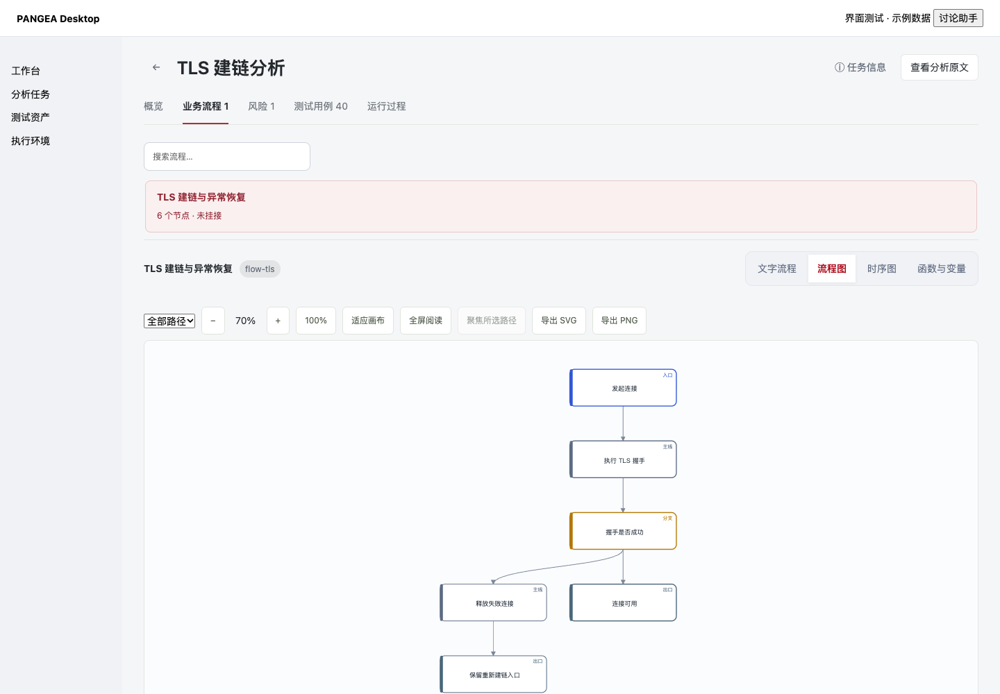

*图 13　流程图展示分支与路径；可选择重点路径、查看节点详情。*

| 图表 | 主要回答什么问题 |
| --- | --- |
| 流程图 | 业务从哪里开始，经过哪些判断，成功或失败后走向哪里。 |
| 时序图 | 不同参与方按什么先后顺序交互。 |
| 函数与变量 | 查看函数、宏及外部函数之间的调用，以及变量的读取、计算和写入。 |

阅读较大的图时，可使用全屏入口；按 **Esc** 退出全屏。普通滚轮用于阅读，**Ctrl＋滚轮**用于缩放。流程图提供 **高亮路径** 和 **聚焦所选路径**，方便单独查看关注的路径。

还可以切换到 **文字流程**，按节点和分支逐项阅读。分支很多时，在 **分支与异常** 中使用搜索、筛选和分页，也可以点击 **绘制本页分支**，在流程图中查看当前页的分支。某次任务没有生成相应图表时，以该任务实际保存的内容为准。

### 从风险追到证据

打开风险后，先看触发条件、系统结果和外部可观察的现象，再核对关联证据及用例。证据详情中的源码片段带有行号，可用于定位依据。

如果需要讨论某条结论，可以使用对象详情中的会话入口，把当前对象和相关内容加入讨论草稿。检查草稿、补充问题后再发送。

## 真实案例中的结果判断

前面的 `storage/tls` 和 42 个文件用于演示操作。下面使用两次保存的真实分析，练习从流程、证据走到用例决定。两次分析均来自 SPDK 源码提交 `97af299e3c76368219f0cddcc710fafd57edcc1c`；被分析仓库为 `spdk-full`。

| 阅读练习 | 原 Run 与完成时间（北京时间） | 原交付状态 |
| --- | --- | --- |
| 连接释放中的并发风险 | `nvme-tcp-chap-tls-260825-01`，2026-08-25 02:03 | COMPLETE / PASS |
| 非法密钥的拒绝行为 | `nvme-of-dh-hmac-chap-aut-260904-04`，2026-09-04 02:10 | COMPLETE / UNRESOLVED |

它们是历史分析阅读案例，历史引擎的准确 Git 提交未在已保存元数据中记录；当前指南界面版本见文末。以下评审判断来自对原产物与冻结源码的核对，不代表这些测试已经执行。可以打开随包的[真实产物与源码节选](evidence/index.html)，查看原始记录、行号和文件校验值。

### 案例一为什么暂不采纳并发断开的原用例

**找到流程。** 在第一个 Run 的报告中查找 **NVMe/TCP qpair 同步断开与 outstanding_reqs 竞态**。这里 qpair 指一条发送命令并接收完成结果的队列连接；outstanding_reqs 是尚未完成的请求队列。流程描述了移除连接、关闭 socket、结束未完成请求，最后确认请求队列为空。

**顺着风险追证据。** 关联风险 `RISK-U00-001` 声称：一个线程同步断开时，另一个线程同时处理完成事件，可能令请求队列再次非空，触发断言。断言是代码对内部状态必须满足的条件所做的检查。点击证据后，应阅读完整函数和接口约束，而不只看带有 `assert` 的一行。

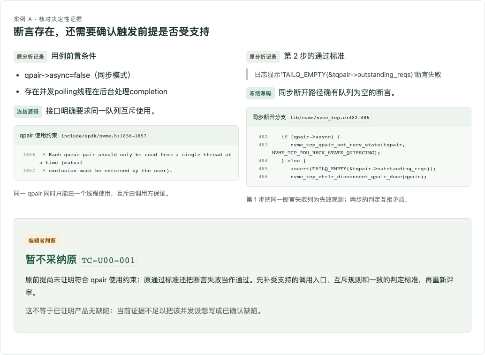

*图 18　真实历史产物节选。用例前提和通过标准保留原文；评审说明结合冻结源码，指出需要重新判断的地方。*

| 核对位置 | 实际看到什么 | 对判断的影响 |
| --- | --- | --- |
| `lib/nvme/nvme_tcp.c:436–488` | 同步断开函数先清理请求，再断言队列为空。 | 确认存在状态检查；尚未证明受支持的调用会触发失败。 |
| `include/spdk/nvme.h:1856–1857` | 同一 qpair 同时只能由一个线程使用，调用者负责互斥。 | 原风险依赖的“两线程同时操作同一 qpair”与该接口约束冲突。 |
| 原用例 `TC-U00-001` 第 1、2 步 | 第 1 步把断言失败列为失败现象；第 2 步却把出现断言失败日志写成预期结果。 | 同一个现象同时被写成通过与失败，无法直接执行。 |

**作出决定。** 对原 `TC-U00-001` 选择 **暂不采纳**。在团队评审记录中写明两点：并发前提未证明属于受支持路径；通过与失败标准相互矛盾。原步骤还直接使用一个内部函数，测试入口也需要重新确定。[查看该例原记录和源码](evidence/index.html#a)。

这不意味着已经证明连接释放毫无风险。若团队有支持并发使用的外层封装，需要补充封装约束和可达调用路径，再重新评审。可继续设计“所属线程内串行提交和断开”的检查，观察请求是否按约定完成或取消、连接是否关闭、能否重新建立连接；这些是后续设计方向。

这次阅读已经产生了价值：避免将不成立的触发前提、矛盾的通过标准直接交给执行人员。原报告的 PASS 也仍然需要用例评审。

### 案例二非法密钥被拒绝为何不等于缺陷

第二个 Run 分析的是 **DH-HMAC-CHAP 身份认证**，即主机与目标端用密钥验证身份的过程。它与 TLS 的通信加密是不同机制，下面的 `DHHC-1` 格式不属于 TLS 密钥格式。

在 **业务流程 / 报告**中找到 **DH-HMAC-CHAP 密钥转换与 HMAC 计算**（`F-U00-FLOW-KEY-TRANSFORM`），再看场景 **DHHC-1 格式密钥解析错误**（`SCN-U00-001`）及用例 **非法 DHHC-1 格式 key 导致认证失败并返回错误码**（`TC-U00-001`）。本例用例的风险关联列表为空，它依据代码流程生成。

打开冻结源码 `lib/nvme/nvme_auth.c:289–324`：格式解析失败会记录 `Invalid key format` 并返回错误；长度错误和 CRC32 校验不匹配也分别被拒绝。CRC32 是这里用于核对密钥内容是否匹配的校验值。因而“错误密钥被拒绝”符合这条路径的保护目的，可以成为异常输入用例。

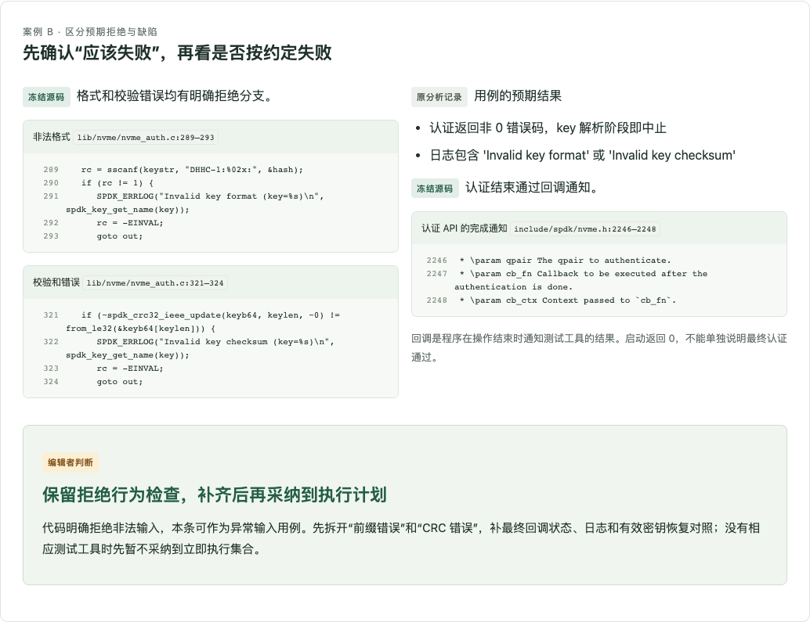

*图 19　真实历史产物节选。密钥拒绝是源码中的明确分支；认证启动返回与最终完成通知需要分别观察。*

同一报告把 **HMAC 校验失败导致连接断开且无自动重试**（`R-U00-004`）列为 High 风险。对应源码确实支持“应答不匹配后拒绝并断开”，但仅凭这一点不能认定为高严重度缺陷。若要把“不自动重试”判成缺陷，还需补充需求依据及恢复失败的实际证据。否则应先把它作为拒绝与恢复行为来验证。[查看原分类与源码](evidence/index.html#b)。

### 把非法密钥用例补到能执行

原用例仍缺少一个关键观察点：`spdk_nvme_qpair_authenticate` **返回 0 表示认证已启动，不代表最终成功**。冻结接口说明 `include/spdk/nvme.h:2246–2248` 指定通过完成回调通知结果；`nvme_auth.c:1268–1270、1290–1294` 展示了启动与回调登记。回调就是程序稍后通知“这次操作结束了”的方式。

| 原用例需要补的内容 | 可执行的完善方式 |
| --- | --- |
| “非法格式”包含多种原因 | 拆成两条：缺失 `DHHC-1` 前缀；保留合法前缀、长度和编码，仅使 CRC32 不匹配。使用专用测试密钥。 |
| 缺少正常对照 | 同一身份和环境先用有效测试密钥完成认证，确认最终回调状态为成功。 |
| 没有明确测试入口 | 使用团队已有、能设置测试 keyring 并触发公开认证接口的测试程序。keyring 是程序读取密钥的位置。确认它会持续处理完成事件。 |
| 只看函数立即返回 | 同时记录启动返回值与最终回调。立即返回非零表示启动已失败；返回 0 时继续等待完成通知，不能提前判定“密钥已被接受”。 |
| 通过与失败边界不清 | 通过：异常输入被拒绝并出现相应错误，未得到认证成功。失败：异常输入得到认证成功或程序崩溃。超过观察期限仍无结果时，先记录挂起，排除完成事件未处理或网络不可达。 |
| 恢复动作不完整 | 换回有效测试密钥，按连接状态重新连接或重新认证，确认最终成功。观察期限按测试环境与团队要求设定。 |

**采纳条件：** 输入能稳定构造，测试入口和最终回调可观测，通过标准与恢复动作都已确认。具备这些条件后，可采纳完善后的用例安排执行；缺少测试程序或观察能力时，先选择 **暂不采纳**，并在团队评审记录中写出缺项。

当前详情页的采纳按钮保存评审决定。上表是用例完善建议；可导出表格，在团队用例库补齐并复核后交付，不要只改变采纳状态就假定原步骤已经改好。第二个 Run 同时显示 COMPLETE 与 UNRESOLVED，也提醒我们继续阅读未完成范围，而不是将已结束理解为全量验证完成。

## 评审并导出测试用例

进入 **测试用例**。可以按 **分析单元、用例类型、执行条件、评审状态** 筛选，也可以搜索用例名称、业务路径、输入或预期结果。

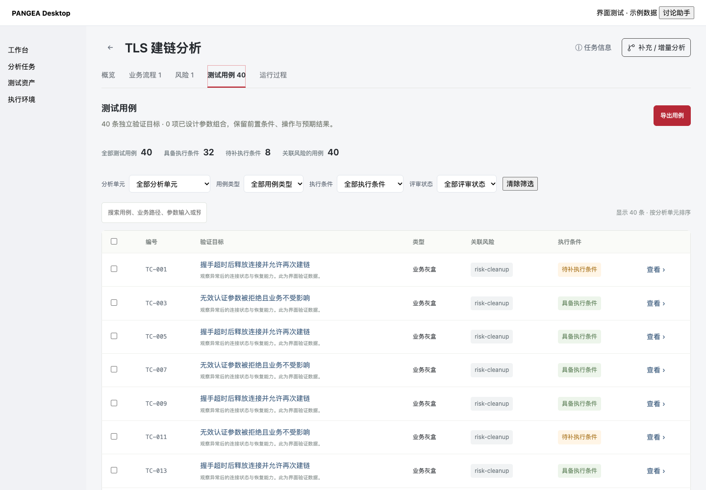

*图 14　先缩小阅读范围，再逐条核对用例。执行条件说明当前准备情况。*

### 逐条判断是否采用

点击用例标题或 **查看 ›**，检查前置条件、操作步骤、预期结果、观察点和清理动作。

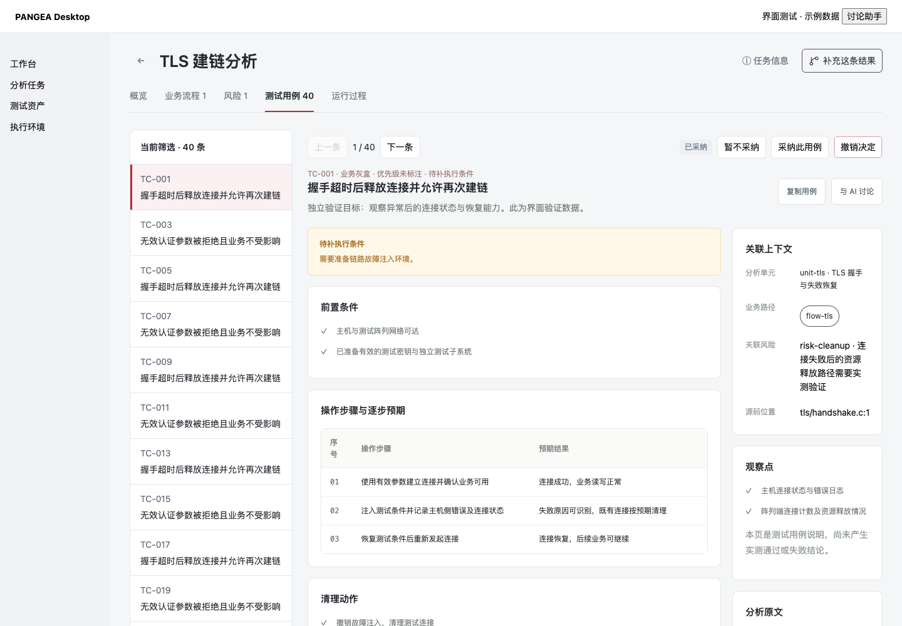

*图 15　用“上一条”“下一条”连续阅读；“采纳此用例”保存评审决定。*

- 适合本次测试工作：点击 **采纳此用例**。
- 暂时不采用：点击 **暂不采纳**。
- 需要重新判断：点击 **撤销决定**。
- 继续阅读：点击 **上一条** 或 **下一条**。

确认页面已经显示保存后的评审状态，再继续。用例内容变化后可能需要重新评审，按页面提示重新核对。

三个常见动作各有用途：

| 动作 | 表示什么 |
| --- | --- |
| 查看 | 打开详情阅读，不自动改变选择或评审状态。 |
| 勾选 | 选中一批用例，便于复制或导出。 |
| 采纳 | 保存你决定采用该用例的评审记录。 |

**“已采纳”和“具备执行条件”都不表示用例已执行通过。** 实际验证结果需要由测试执行记录确认。“待补执行条件”的用例，应先补齐环境、工具或其他前提。

### 选择正确的导出范围

在测试用例页打开导出窗口；已勾选用例时，也可以点击 **导出所选**。

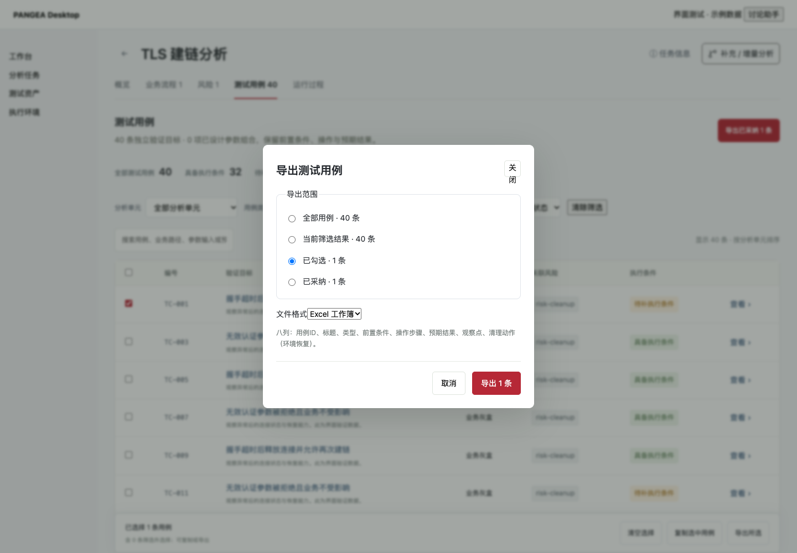

*图 16　示例数据：导出前核对范围和条数，再选择 Excel 工作簿或 CSV。*

| 导出范围 | 包含的内容 |
| --- | --- |
| 全部用例 | 当前运行中的全部用例。 |
| 当前筛选结果 | 符合当前筛选条件的用例，包含后续分页中的匹配项。 |
| 已勾选 | 当前勾选的用例。改变筛选条件后，之前勾选的项可能仍被保留。 |
| 已采纳 | 已保存为采纳状态的用例。 |

1. 选择范围，核对显示的条数。
2. 选择 **Excel 工作簿** 或 **CSV**。
3. 点击 **导出 N 条**，保存文件。
4. 打开导出的表格，检查数量、标题和步骤是否符合本次交付需要。

表格包含八列：**用例ID、标题、类型、前置条件、操作步骤、预期结果、观察点、清理动作（环境恢复）**。

如果页面提示“含 N 条筛选外选择”，说明导出已勾选项时还会包含这些条目。想只导出当前筛选结果，就直接选择对应范围；想重新选择，先点击 **清空选择**。范围为 0 时，先调整筛选或选择。

### 保存报告

在结果概览点击 **查看分析报告**，进入报告页后点击 **打开已有报告**；也可以从 **交付文件** 中分别打开 `report.html` 或 `report.md`。运行过程页出现 **查看报告** 时，也能直接打开当前报告。

分享时一并说明仓库、分析目标、所用源码版本，以及报告中的未解决事项。测试用例表格和分析报告各有用途：前者便于安排执行，后者保留分析依据、复核情况和交付范围。

## 补充需求和历史缺陷资料

首次流程走通后，可以加入资料，让后续分析更贴近实际业务。

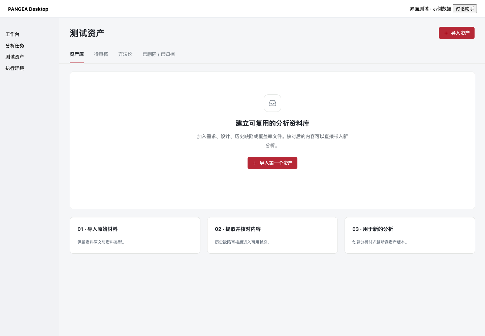

*图 17　先将资料导入资产库，处理完成并核对后，再加入新的分析。*

1. 打开 **测试资产 → 导入资产**。
2. 选择 **一般资料**及合适的 **资料类型**，再点击 **选择文件**。一般资料支持 Markdown、TXT、PDF、Word 和 Excel；支持一次选择多个文件，同批文件使用相同类型和处理设置，单文件不超过 24 MiB。
3. 对需要模型提取的资料，按页面选择处理 Agent 和模型。覆盖率文件由本机解析。
4. 检查导入预览和处理设置，点击 **导入并处理**，等待资料处理完成。
5. 打开详情，核对提取内容和原文是否相符。
6. 对历史缺陷资料，完成逐条审核或点击 **审核通过**，使可接受内容进入可用状态。
7. 在新建分析的 **输入资料** 步骤中，选择本次需要的可用资产。

资料显示 **等待处理、提取中、待人工审核** 时，还需要完成相应处理。**已分析但无可用内容**时，核对资料分类和原文，再决定是否重新处理。

## 源码更新后重新分析

原目录更新后，PANGEA 中的已导入副本和旧 Run 仍保留原来的内容。第一次处理版本更新时，采用 **新版本、新仓库名称、新任务** 的方式，便于把结果与源码对应起来。

1. 在 PANGEA 外准备更新后的源码目录，确认它就是本次要测试的版本。导入期间保持目录内容稳定。
2. 回到工作台，点击 **添加仓库 → 选择文件夹**，选择更新后的原始目录。
3. 将 **仓库名称** 改成新的名称，例如 `storage-20261022` 或团队交付版本名 `storage-R2`。已有同名仓库会被拒绝，旧副本保持原样。日期只帮助识别，实际版本要在冻结清单中核对。
4. 核对页面 **目标位置**，点击 **添加仓库**，等待新名称出现在列表。
5. 点击 **新建分析**，选择新仓库，重新检查目标、主范围、参考范围和资料版本，再次 **预览命中文件**。新增或移动文件可能改变范围。
6. 创建后，打开 **运行过程 → 02 分析单元划分 → 阶段任务 → 阶段产物 → 冻结源码清单（source-manifest.json）**。准备阶段尚未完成时，清单可能还没生成。
7. 得到新报告后，用新仓库名称和新 Run 编号分享结果，并重新评审适用的用例。

### 在冻结清单里核对版本

找到 `repositories` 中对应的 `repo_id`，再核对 `git` 字段：

| 字段 | 怎样理解和核对 |
| --- | --- |
| `git.commit` | 本次记录的完整 Git 提交号，应与准备导入的版本一致。 |
| `git.branch` | 当时的分支名。同一分支会继续变化，不能只凭分支名认定版本相同。 |
| `git.dirty` | `true` 表示副本中含未提交修改或未跟踪文件。此时提交号不能单独描述全部输入，以 Run 保存的文件为准。 |
| `git.is_git: false`、`version_status: "unversioned"` | 导入的是普通目录，没有 Git 提交号。保留交付版本说明和原始源码包，记录仓库名称、Run 编号及本次范围。 |

如果你使用 Git，但不知道原目录的提交号，可在 Windows PowerShell 中运行以下只读命令；路径替换成自己的源码目录：

```powershell
git -C "D:\Code\storage" rev-parse HEAD
git -C "D:\Code\storage" status --short
```

第一条输出完整提交号，第二条有内容表示工作目录还有变化。两条命令不会更新源码。任务信息抽屉可以查看仓库、Run 和范围；Git 提交号请以冻结源码清单为准。

### 何时使用补充或增量分析

任务页的 **补充 / 增量分析** 会打开 **基于此结果继续分析**：

- **定向补充**使用原 Run 冻结的源码和资料，适合补问同一版本的问题。
- **按变更文件分析**读取当前工作区内同一个仓库的文件，与旧 Run 比较。它本身不更新源码。仅在维护者已经更新该工作区副本、且能明确列出新增、修改、删除文件时使用。

原 Run 需要已完成或已停止，冻结输入和结果仍可读取。按上面“新名称重新导入”的方式更新源码后，直接新建任务即可。旧报告中的采纳记录属于旧版评审，需要在新版重新核对。

## 按现象排查问题

先记下**所在页面、完整错误文字、发生时间、任务与 Run 编号**，再按下面的分支处理。“重试读取”只刷新页面数据；“继续分析”会恢复任务执行，二者用途不同。

### 找不到执行器

**现象：** 创建页提示“所选外部 Agent 尚未加载”或“未找到命令”。打开 **Agent Runtime → 高级启动设置与诊断**，查看命令解析和绝对路径。

1. 在 PowerShell 执行 `Get-Command -CommandType Application opencode`。也找不到时，回到执行器安装步骤处理安装或 PATH，随后重新打开 PowerShell。
2. PowerShell 能找到，但 Desktop 路径为空或仍是旧路径时，重新启动 Desktop；自定义安装则填写实际 `.exe` / `.cmd` 路径与参数 `acp`，保存后在无运行任务时重启 Harness。
3. 命令能找到，但 `opencode.cmd acp --help` 不存在时，检查安装代际和版本。不要反复创建分析来测试命令是否可用。

**恢复标志：** 执行器已加载，刷新模型成功，具体模型可选且得到确认。仍失败时提供 Desktop 版本、执行器版本、命令解析结果、隐藏用户名后的路径和错误摘要。

### 模型与网络问题

**在哪里看：** 创建页 **Agent 模型**下方的提示；已启动任务则看 **运行过程 → 运行信息 → 启动诊断**，以及 **执行详情与 Agent 会话 → Agent 会话管理**。需要更完整信息时打开页面提供的 **完整诊断**。

| 诊断中看到什么 | 优先区分哪种原因 |
| --- | --- |
| 原选择的模型已不在当前列表中 | 模型目录发生变化，重新选择实际可用的模型。 |
| Agent 未返回可用模型 | 先执行 `opencode.cmd models`；自定义网关核对供应商 ID、模型 ID 和配置位置。空列表不能用一个未经确认的默认模型跳过。 |
| 实际错误含 `401`、`403`、`unauthorized` | 核对当前登录凭据与该模型的访问权限。 |
| 实际错误含 DNS、连接拒绝、证书或超时 | 分别核对地址解析、服务地址、企业证书、代理与网络。不能仅凭“超时”认定账号失效。 |

修复后，用**同一个模型**执行前文的短请求。若执行器自身仍报错，先继续处理该错误。短请求成功后回创建页 **刷新模型**，确认具体 ID。

已有 Run 时，先确认它的执行状态。只有页面提供可用的 **继续分析 / 继续修正**，且没有“旧工具仍可能运行”的阻塞，才在原 Run 继续。**恢复标志：** 模型请求恢复、页面确认模型，并且原 Run 出现新的事件或产物。仍失败时附时间、Agent 与模型 ID、错误摘要及 Run 编号；不要附完整认证文件。

### 源码命中为零或提示范围变化

**在哪里看：** 新建分析的 **分析目标 → 预览命中文件**。

命中为 0 时，先核对当前选中的仓库。路径相对仓库根目录填写，例如 `tls/`，不要填另一台电脑的路径。用 **选择目录或文件**查看实际目录，再预览。当前支持 C/C++ 与 Lua；目录展开还有默认排除规则，不能用资源管理器里“目录有文件”代替预览结果。若目录都是其他语言或被排除的文件，扩大同一个路径也不会自动变成可分析范围。

提示范围已经变化时，说明创建所用文件集合与上次预览不一致。重新预览，重点核对新增、移动或删除的文件，然后再创建。参考范围报错时，确认每行是存在的具体文件，并移除与主范围重复的条目。

**恢复标志：** 清单中出现预期入口、状态判断与清理实现，主范围命中数大于 0，下一步可点击。仍不行时提供仓库名、主/参考范围文本、预览错误和预期文件的相对路径。

### 页面显示上次结果或资料暂不可读

**现象：** 运行过程顶部提示 **同步失败，正在显示上次结果**，并显示“最后成功读取于 …”。这是页面读取失败，后台是否仍在分析需要重新确认。

点击 **重试读取**。这只重新读取状态，不重新派发分析。看到最近同步时间更新、警告消失、当前阶段恢复显示，才说明页面读取恢复。持续失败时保留最后成功时间、Run 编号和错误文字，不用新建同任务替代读取恢复。

若提示 **部分运行资料暂不可读取**，记录具体产物名称，再重试读取。资料恢复后才能使用其中的数量或结论；读不到风险列表不能解释成“0 个风险”。持续失败时提交具体文件名与错误，保留原 Run 文件。

### 工具结束状态未确认

**现象：** 显示 **等待工具确认**、**工具结束状态未确认**或“原 ACP 请求或工具仍可能运行”。这表示某个工具可能已经执行，但系统尚未获得可靠的结束通知。`pending` 不证明工具没有执行；Agent 回合结束也不证明工具成功。

1. 打开 **执行详情与 Agent 会话 → Agent 会话管理**，进入对应单元/会话，查看 **工具结束确认诊断**。核对尚无结束确认的数量、工具 ID、最后更新时间以及 `pending / in_progress / unknown` 状态。
2. 展开 **运行信息 → 启动诊断**，查看请求、会话、最近工具、未结束工具数和进程退出信息。留意“旧执行已停止，核对保存结果”“检查已保存结果”“恢复原会话”等事件。
3. 如果仍提示“旧执行进程树停止尚未确认”“原请求或工具仍可能运行”或 **暂不能继续**，保留原 Run，等待延迟确认或交由维护者检查。此时不要重复创建同任务、删除记录、手动重放工具命令或批量结束 Agent 进程。仅看到一个根进程退出还不够。
4. 只有诊断已明确确认**原回合及工具结束，或旧执行的整个进程树已停止**，并且页面 **继续分析 / 继续修正**可点击时，才续接原 Run。提示可能是“原回合与工具均已确认结束，可继续原会话”，也可能是“已确认旧执行进程树停止；保留原工具记录，正在核对已保存结果”等。如果自动恢复已经推进，继续观察即可。
5. 核对恢复结果：同一 Run 保留已有产物，出现新的完成记录、已接受单元或进入下一阶段。旧工具记录会保留，不以它从列表消失作为成功标准。

当前版本对 CodeAgent 的特定情况可自动尝试一次恢复：先确认整个受管进程树已停止，核对保存结果，再续接原会话未完成部分。这不是所有执行器都有的通用重试。若仍缺结束确认、保存结果不可读或提示不支持恢复，带诊断联系维护者。

**仍无法恢复时：** 展开 **完整工具诊断 JSON（可复制）**，点击 **复制工具诊断**；附启动诊断以及页面提供的完整诊断文件。说明是否曾点击停止或继续，保留操作时间。

### 交给维护者的信息

按以下清单提交即可定位到具体运行：

- Desktop 当前版本及组件提交、执行器版本、实际模型 ID。
- task / Run 编号、发生时间、错误原文、你刚做的操作。
- 工具确认问题另附 action、remote session、request ID 和工具诊断 JSON。
- 页面读取问题附最后成功同步时间；范围问题附相对路径与预览结果。

发送前移除 API Key、Authorization、Cookie、代理密码及无关源码正文。保留原始文件在本机，分享脱敏副本；这些诊断 ID 和时间应保留，便于关联事件。

## 升级和保留数据

日常升级可从 **设置 → 版本与升级** 导入团队提供的原始签名 ZIP。升级包无需提前解压。

1. 先让正在运行或排队的分析、资料处理等任务完成或确认停止。
2. 导入升级包，等待校验，核对目标版本。
3. 点击 **安装并重启**，等待应用重新打开。
4. 回到工作台，确认任务和历史结果仍可读取。

补丁包要求当前安装版本与它的基线匹配。当前升级入口要求源版本至少为 **2.0.20**。若提示版本不匹配，使用适用的完整包；若为 **2.0.19 或更早版本**，在独立目录安装完整包并保留旧目录及用户数据。独立安装有独立的工作区，不能假定新程序会自动显示旧任务。

当前受支持的应用内升级会复制 `launch-root` 等用户目录，再切换程序目录。升级完成后仍需核对仓库列表、历史任务和报告。手动重新解压完整包时，完整保留旧安装目录中的 `launch-root` 与 `%APPDATA%\pangea-desktop`，在确认数据迁移和历史结果可读前不要删除旧目录。

## 第一次使用完成检查

完成以下几项后，你已经走通一次从源码到测试设计的基本流程：

- 已添加正确的源码仓库，并预览确认分析范围。
- 已选择可用的执行器和具体模型，成功创建任务。
- 已查看运行状态，处理或明确保留需要关注的事项。
- 已阅读流程、风险或相关证据，以及本次交付报告。
- 已评审至少一条用例，并按明确范围导出表格。
- 已区分分析结论、人工采纳决定和实际测试执行结果。

接下来，可以扩大模块范围、加入需求和历史缺陷资料，或在准备好执行环境后安排测试执行。

## 版本与资料依据

本指南对应以下 `langgraph` 源码快照。分支会继续更新；复核按钮或行为时，请使用固定提交。

| 部件 | 固定提交 |
| --- | --- |
| PANGEA Desktop | [`a23cd31145a71e3997b617eb809950a00f20f4b8`](https://github.com/CyberShp/pangea-desktop/commit/a23cd31145a71e3997b617eb809950a00f20f4b8) |
| 工作台插件 dsh-pangea | [`7cc5179a30c3beefd61ea4792558c6fc8e8dc73a`](https://github.com/CyberShp/dsh-pangea/commit/7cc5179a30c3beefd61ea4792558c6fc8e8dc73a) |
| 分析引擎 pangea-agent | [`7aa7abc3e921173409787f22e23ca872318baffd`](https://github.com/CyberShp/pangea-agent/commit/7aa7abc3e921173409787f22e23ca872318baffd) |

**先对照自己安装的产品。** 打开 **设置 → 版本与升级**，记录“当前版本”。在程序安装目录中，用记事本只读打开 `resources\update\pangea-package-manifest.json`，核对 `version`、`channel` 和 `components`；也可查看 `resources\pangea-manifest.json` 中的组件信息。保留这些文件原样。

- `stable` 表示正式包通道；`test` 表示测试包通道，测试包版本格式带有 `-test.<序号>.<提交短标识>`。
- 当前文档核对的是上述源码快照。具体安装包是否已包含这些功能，以该包的组件清单为准。
- 仓库 `package.json` 的版本字段为 `1.0.4`；打包脚本允许指定发行版本，因此不能用这个字段推断你安装的产品版本。

遇到按钮名称或页面结构不同，先核对版本和组件，再使用匹配的指南或升级包。文档包内的 `source-record.json` 保存来源与图片校验记录，方便 Wiki 维护者更新。
