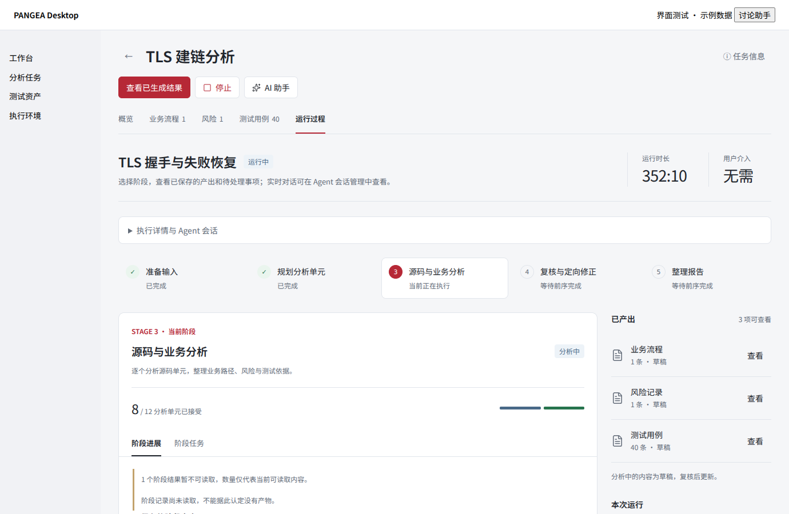
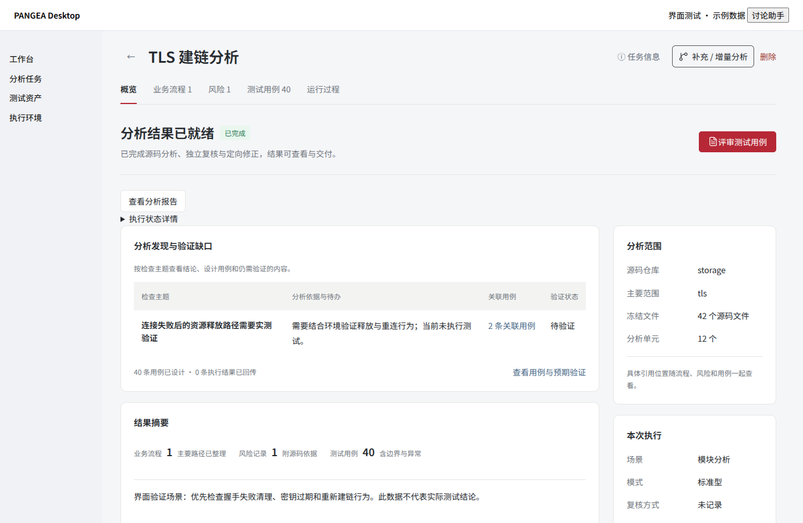
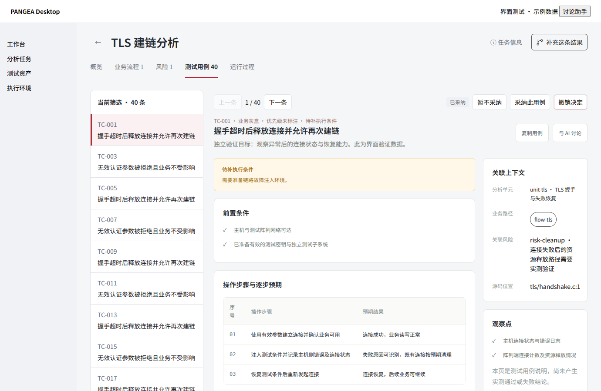
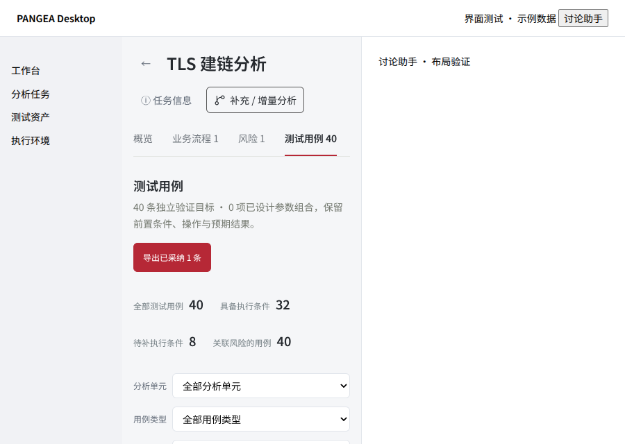

# UI/UX 开发交付与内网验收

状态：三个仓库的 UI/UX 与最新 `langgraph` 已完成集成，原生全屏修复及针对性验证已完成。组件锁使用 `langgraph` 分支及已验证的配套提交；原内测包与本地开发补丁的证据分别记录。

## langgraph 合入记录

- 合入范围为既有 UI/UX 配套提交与本次原生全屏修复，三个仓库均保留已同步的 `langgraph` 历史；组件 SHA 与原生验证时一致。
- Desktop 仅将两个组件的分支标记切换为 `langgraph`，没有改写历史测试结果。发布契约与运行时、staging、升级策略、补丁生成、Windows 发布检查共 73 项通过；此前的发布分支契约失败已消除。
- 既有插件重启桥接契约、模型全选国际化及其他测试环境/断言差异仍按已披露问题跟踪；合入不代表全量测试已通过。

## 本地集成与原生修复（2026-10-21）

- Desktop 集成 `2608c60`，保留最低升级源 2.0.20 等独立改动；仅向既有受信任 HTTP loopback 主 frame 放行 `fullscreen`，仍拒绝子 frame、外部页面和 `automatic-fullscreen`。
- dsh-pangea 集成 `43aa37b`，当前配套提交 `7cc5179a30c3beefd61ea4792558c6fc8e8dc73a`。全屏状态与按钮文案同步，失败可见；支持 Esc 退出；流程图和时序图的内容包装层填满剩余高度，详情独立滚动。
- Agent 集成 `3a783dc`，当前配套提交 `7aa7abc3e921173409787f22e23ca872318baffd`；保留范围预览与图表合同改动。
- 原生 Electron 使用真实 `e2e-261021-01` Run 完成 11 项回归：鼠标全屏、窗口全屏状态、剩余画布高度、缩放、按钮退出、Esc、路径选择保留、时序图和调用图、25 条用例及采纳决定重启恢复。没有重新调用模型；模型端到端执行证据沿用本日已完成的真实 Run。
- Companion 708 通过 / 8 跳过，Shell 37 通过，浏览器 32 通过，Agent 24 通过，真实范围引擎 1 通过；Desktop 受影响测试 67 通过、typecheck/build 通过，发布工具 147 通过 / 16 跳过，包内 Cordis 11 通过，Windows ACP 6 通过。
- Desktop 全量为 633 通过 / 3 跳过 / 11 失败。这 11 项在原始 `b32c2b8` 与相同依赖环境下均复现：6 项静态契约、2 项 Python 商店别名、2 项路径/夹具、1 项发布分支硬编码。此处不把全量结果记为通过。
- Run 只读审计 45 项通过。任务 `complete + UNRESOLVED` 对账为 `needs_attention` 是既有行为，执行状态仍为 completed；原审计断言已在集成审计副本中按既有规则纠正，原始证据与 Run 保留。

证据目录：`D:/pangea-desktop-project/runtime-validation/uiux-acceptance-20261021/`。入口为 `integration-report.txt`，原生检查为 `integration-native-check.json`，截图为 `integration-native-evidence/`。本地实例在原 `win-unpacked` 上应用已备份的开发补丁，未重写签名 ZIP。Windows 三档系统缩放及内网真实业务的剩余验收仍按后文门槛执行。

## 原功能分支交付基线

三个仓库统一使用 `feat/uiux-workbench-20261021`。执行规格是同目录 `2026-10-21-uiux-plan.md`（v1.1）；实际配套提交以 `pangea.components.json` 为准。后续修复提交继续留在该分支，禁止提前启用自动合并。

| 工程 | 分支起点 | 已验证组件提交 |
| --- | --- | --- |
| Desktop | `f8f98c0ea03948158305463558d1f5ce94752119` | 当前分支提交；构建证据记录实际 HEAD |
| dsh-pangea | `d18b4484da29bbcc79d531662a3682d02eb3246e` | `d726d2b9cb672a6d1feb1aabf2dadfcdd8607b4b` |
| pangea-agent | `92e84bd46aefcd5dded685d664d47342ff3d5116` | `470b4869869447f07a14d65934791d5a2f75f10b` |

## 已完成的开发范围

| 原问题 | 实现与主要入口 |
| --- | --- |
| 标题上下两行小字、字体与主动作不一致 | Shell `src/ui-components.js` 提供共享 PageHeader 等组件；`src/product-ui.css` 统一字体、主色、标题和内容宽度响应式；Companion 与资产主页面迁移简洁页头；任务元信息放可键盘操作的抽屉 |
| 新建默认整仓、范围不可确认 | 范围初始为空；目录/文件选择、明确整仓、真实命中文件清单和分页；Companion `src/repositories/scope.js` 调用引擎同一枚举；创建前和冻结期间核对范围版本；预览失败或 0 命中不启动 |
| 模型配置用途混淆 | 设置分为“分析执行器”“讨论助手模型”；分析保持外部 Agent/模型就绪检查，内部 API 状态不阻断外部分析 |
| 运行、会话信息重复且难定位 | 运行阶段条、业务任务主体、低权重结果侧栏；执行详情折叠；错误直接可见；阶段任务按 action/attempt/unit 定位会话；匹配不唯一时提示选择，避免打开其他成功尝试 |
| 会话正文和工具输出难阅读 | 安全 Markdown 正文、最新信息优先、阶段/状态/单元筛选、已加载事件搜索；工具原文默认折叠，失败摘要保持可见；历史和原始记录仍可读取 |
| 概览缺少重点 | `src/overview-findings.js` 优先投影未解决项、风险与明确记录，保留来源；不使用用例预期结果冒充发现；失败/停止中与完成状态区分；按状态给主要操作 |
| 分支筛选与分页隐藏 | 检索、状态过滤、总数、20 条分页贴近分支表；原文独立折叠；普通滚轮阅读、Ctrl+滚轮缩放、全屏和所选路径聚焦；函数变量说明不参与 SVG fit，独立导出保留元数据和提示 |
| 用例反复进出、缺筛选与范围导出 | 单元/类型/执行条件/评审状态筛选，50 条分页；主从阅读与上一条/下一条；焦点、勾选、持久评审分离；重复显示编号不作身份；缺失/重复稳定身份仍分别可读 |
| 采纳保存和导出一致性 | `src/case-review-store.js` 独立原子存储与 revision/content_hash CAS；内容变化需重新评审；全部/筛选/勾选/采纳四范围；CSV/XLSX 实际行集及八列一致；空范围不退回全量 |

原始 Run、分析记录和报告保持只读。没有改变 ACP 派发/停止/恢复协议，也没有新增源码或用例的语义门禁。引擎改动只补只读范围投影、可选冻结版本确认和派生 Run 不继承父任务的旧范围确认。

## 本地验证证据

`uiux-verification/checks.json` 记录实际检查数和组件提交。最终影响范围检查：

- Companion：696 项，688 通过、8 条件跳过、0 失败；包含真实 Python CLI 创建 Run 后对比完整冻结集合、路径越界/忽略/中文与逗号路径/读取故障/范围变更，以及四种范围 CSV/XLSX 行集验证。
- Shell：37 项全部通过。Asset Catalog：108 通过、1 条件跳过。
- Desktop：13 个核心测试文件，169 通过、1 条件跳过；发布工具测试 163 项通过；typecheck 和 Electron main/preload 构建通过。
- Chromium 153：28 个检查点通过，包含 1380×900、1280×720、1920×1080、900×640、助手开关、采纳刷新持久化、筛选外勾选与精确导出、120 条分页、会话 Markdown/工具失败、滚轮/全屏/路径聚焦及 42 文件范围预览。

浏览器验证运行真实 React 组件，范围、评审与导出使用实际 API；业务分析与外部 Agent 使用隔离示例数据，桌面外框为测试壳。**这些截图不能替代原生 Electron、内网执行器连通性、Windows 100%/125%/150% 缩放或真实用户 5 秒识别测试。**

首次扩大 Desktop 整库检查曾出现未修改模块的旧源码断言差异和并发超时，未记为整库通过；准备隔离依赖、执行正式模型入口安装脚本、降低测试并发后，上述核心范围全部通过。没有为了此次 UI 改动修改品牌、移动桥接或发布说明等无关断言。Companion 一个已有的 80ms 定向修正预算测试在基线与本次回归均出现持久化调度超时，已仅将 fixture 窗口放宽到 1000ms，生产预算不变。

核心界面截图：

## Windows 可测试实例

分支专用工作流 `.github/workflows/uiux-internal-test.yml` 在该分支组件锁或自身变更时构建；只上传开发版 `win-unpacked` 和检查证据，不创建 Release、不合入主分支。固定组件 staging、插件测试、桌面核心检查和真实引擎范围一致性通过后，构建独立的 **PANGEA Desktop Dev**，使用临时 profile 验证 Harness readiness。

Windows 内测构建已通过：[工作流与检查日志](https://github.com/CyberShp/pangea-desktop/actions/runs/39582994144)；版本 `1.0.4-test.3.cabfa63`，构建提交 `cabfa634571e91973898df8ef65537c5106c9a73`。Windows 侧桌面检查 189 项、真实范围/冻结检查 1 项、打包 Cordis 集成 11 项全部通过；原生程序的隔离 profile readiness 已确认，记录见 `uiux-verification/windows-smoke.json` 和 `windows-manifest.json`。

下载 [Windows 内测包](https://github.com/CyberShp/pangea-desktop/actions/runs/39582994144/artifacts/12339196489) 并解压，双击 `start-uiux-test.cmd`。入口把 `PANGEA_USER_DATA_DIR` 指向解压目录内 `uiux-test-profile`，与正式程序数据分开；不移动或覆盖正式 profile。实际构建版本和组件 SHA 位于配套 evidence 制品。构建失败时按工作流日志修复，不手工修改签名 ZIP。

本次环境没有内网 Windows 交互入口与真实 Agent 凭据，因此原生缩放及内网任务由该实例完成验收。开发者可复现组件验证：Companion `scripts/preview-ui.mjs` 和 `scripts/verify-ui-browser.mjs`；其参数及外部测试工具说明在 Companion README，产品依赖不变。

## 合入门槛与后续接手

在内网实例逐项确认后，把结果与实际提交记录到本节：

1. 新建 TLS 分析：首次空范围、子目录/整仓及真实文件数正确；修改范围或确认后文件集合变化会要求重新预览；外部模型就绪检查与助手内部模型互不误阻断。
2. 实际运行/失败/停止中/继续：状态、关键错误、单一主要动作一致；失败任务打开对应尝试会话，工具原文可达且不默认挤满首屏。
3. 用例连续评审与重启：查看、勾选、采纳互不替代；撤销/冲突/保存错误可见；四种导出范围的行集和八列与界面相符。
4. 20 条以上分支、长变量说明：完整检索、分页、普通滚轮、Ctrl 缩放、全屏退出和选择保留正常。
5. Windows 三种缩放、最小窗口和助手展开：操作可达，无页面级横向溢出；设置、资产和环境页面页头一致。

验收记录当前为 **待内网确认**。开发期间远端 langgraph 还有独立更新，且与本功能分支分叉：dsh-pangea `43aa37b9b099037a088d73ffd428647e1a89bf9e`（调用图/时序图），Agent `3a783dc564a18267904d37f0ff964c91f16a8773`（流程规则），Desktop `2608c60c1f4ca99a5f89d809b606c1d6b956aa43`（组件锁/发布配置等）。内测包保留上表所列已验证基线和固定提交。合入前必须先将最新 langgraph 同步到功能分支，保留这些独立修改，重建 lib 并重跑受影响检查；若运行或 UI 行为变化，再做相应内网复测。通过后才评审三个仓库的配套功能提交并合入 langgraph；此开发包不启用自动合并。若有问题，直接在同一功能分支修复，更新检查证据与 Desktop 组件锁后重建。
